<div align="center">



<br/>

<a href="#perkenalan"></a>
<a href="#introduction">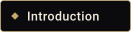</a>
<a href="#sekilas"></a>
<a href="#terminal"></a>
<a href="#latar-akademik">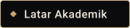</a>
<a href="#cara-kerja">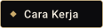</a>
<br/>
<a href="#bahasa-pemrograman"></a>
<a href="#framework-dan-tools"></a>
<a href="#web-dan-aplikasi"></a>
<a href="#elektronika-dan-iot"></a>
<a href="#komponen-elektronika">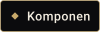</a>
<br/>
<a href="#rumus-dasar"></a>
<a href="#logika-digital"></a>
<a href="#protokol-komunikasi"></a>
<a href="#arduino-uno"></a>
<a href="#peralatan-lab"></a>
<a href="#code-showcase">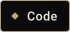</a>
<br/>
<a href="#pipeline-proyek"></a>
<a href="#dokumentasi-proyek">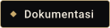</a>
<a href="#game-lab">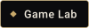</a>
<a href="#alur-kerja"></a>
<a href="#peta-belajar"></a>
<a href="#tanya-saya">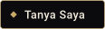</a>
<a href="#statistik-github"></a>
<a href="#kontak">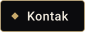</a>

<br/>


<br/><br/>


</div>

<div align="center">

<a name="perkenalan"></a>
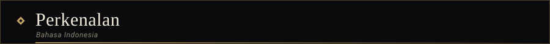

</div>


Halo, aku **Nicho**, mahasiswa jurusan Elektronika yang juga senang menulis kode. Bagiku, dua bidang ini saling melengkapi: perangkat lunak memberi "otak" pada rangkaian, sedangkan rangkaian membuat perangkat lunak bisa berinteraksi dengan dunia nyata.

Aku tidak mengejar kerumitan hanya demi terlihat hebat. Prinsipku sederhana: buat versi yang berjalan terlebih dahulu, lalu perbaiki sedikit demi sedikit. *Code, build, improve, repeat.*

Saat ini aku sedang memperkuat dasar pemrograman C dan C++, mendalami Flutter dan Dart, serta mengubah ide-ide menjadi proyek yang benar-benar berguna. Jika kamu tertarik pada perangkat lunak, perangkat keras, atau perpaduan keduanya, aku senang berdiskusi dan berkolaborasi.

<div align="center">

<a name="introduction"></a>
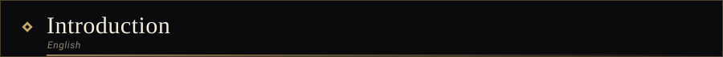

</div>


Hi, I'm **Nicho**, an Electronics student who also loves writing code. To me the two fields complete each other: software gives a circuit its brain, and circuits let software reach into the physical world.

I don't chase complexity just to look impressive. My approach is simple: build a version that works first, then improve it bit by bit. *Code, build, improve, repeat.*

Right now I'm strengthening my C and C++ fundamentals, going deeper into Flutter and Dart, and turning ideas into projects that are genuinely useful. If you're into software, hardware, or the space where they meet, I'd love to talk and collaborate.

<div align="center">

<br/>


</div>

<div align="center">


</div>

<div align="center">

<a name="sekilas"></a>
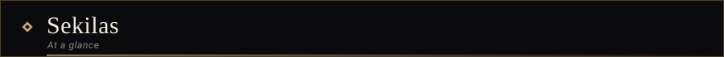

</div>


<div align="center">

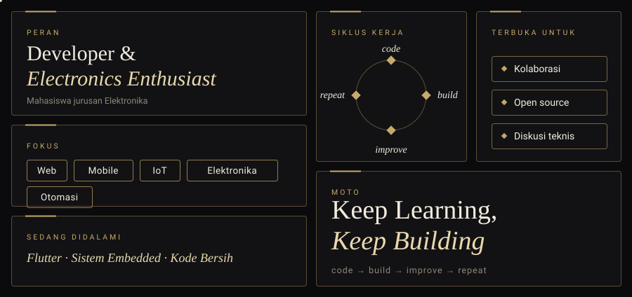

</div>

<br/>

| | Bahasa Indonesia | English |
| :--- | :--- | :--- |
| **Peran / Role** | Developer dan Electronics Enthusiast | Developer and Electronics Enthusiast |
| **Status / Status** | Mahasiswa jurusan Elektronika | Electronics student |
| **Fokus / Focus** | Web, aplikasi mobile, IoT, elektronika, otomasi | Web, mobile apps, IoT, electronics, automation |
| **Sedang didalami / Learning** | Flutter, sistem *embedded*, kode yang bersih | Flutter, embedded systems, clean code |
| **Terbuka untuk / Open to** | Kolaborasi, *open source*, diskusi teknis | Collaboration, open source, technical talk |
| **Moto / Motto** | Terus belajar, terus membangun | Keep learning, keep building |

<div align="center">


</div>

<div align="center">

<a name="terminal"></a>
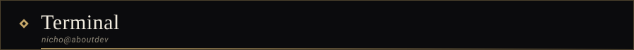

</div>


<div align="center">


<br/><br/>


</div>

<br/>

```ts
// nicho.config.ts
const nicho: Developer = {
  role:   "Developer & Electronics Enthusiast",
  status: "Electronics student",
  focus:  ["Web", "Mobile", "IoT", "Electronics", "Automation"],
  stack:  ["Dart", "Java", "C++", "C", "JavaScript", "Python"],
  loop:   ["code", "build", "improve", "repeat"],
  motto:  "Keep Learning, Keep Building",
};
```

<div align="center">


</div>

<div align="center">

<a name="latar-akademik"></a>
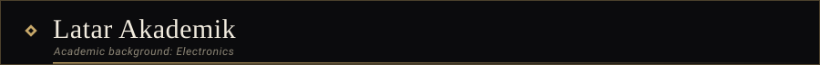

</div>


Bidang kajian umum di jurusan Elektronika dan kaitannya dengan proyek yang aku kerjakan. Nama dan urutan mata kuliah dapat berbeda di setiap kampus.

| Bidang kajian | Yang dipelajari | Kaitannya dengan proyek |
| :--- | :--- | :--- |
| **Rangkaian Listrik** | Hukum Ohm, hukum Kirchhoff, rangkaian seri dan paralel | Menghitung resistor, arus, dan daya |
| **Elektronika Analog** | Dioda, transistor, penguat operasional | Pengondisian sinyal dari sensor |
| **Elektronika Digital** | Gerbang logika, aljabar Boolean, *flip-flop*, *counter* | Logika kontrol dan penghitung |
| **Mikroprosesor dan Mikrokontroler** | Arsitektur, register, *timer*, interupsi | Pemrograman Arduino dengan C dan C++ |
| **Sinyal dan Sistem** | Sinyal analog dan digital, *sampling*, filter | Pembacaan sensor dan ADC |
| **Instrumentasi dan Pengukuran** | Multimeter, osiloskop, sensor, kalibrasi | Pengujian dan verifikasi rangkaian |
| **Sistem Tertanam** | *Firmware*, protokol komunikasi, manajemen daya | Proyek IoT |
| **Pemrograman** | C, C++, Java, Python, struktur data | Perangkat lunak yang menjalankan perangkat |

<div align="center">


</div>

<div align="center">

<a name="cara-kerja"></a>
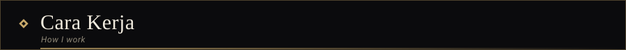

</div>


| Prinsip | Penjelasan | In practice |
| :--- | :--- | :--- |
| **Berjalan dulu, rapi kemudian** | Versi sederhana yang berfungsi lebih berharga daripada rencana sempurna yang tak pernah selesai. | A working draft beats a perfect plan that never ships. |
| **Langkah kecil** | Pecah pekerjaan menjadi bagian kecil yang mudah diuji satu per satu. | Break big problems into pieces small enough to test. |
| **Kode yang mudah dibaca** | Tulis untuk manusia terlebih dahulu, mesin menyusul. | Write for humans first; the machine will cope. |
| **Uji di dunia nyata** | Rangkaian yang berhasil di simulasi belum tentu berhasil di meja kerja. | A circuit that works on paper still has to survive the bench. |
| **Catat yang dipelajari** | Setiap proyek meninggalkan catatan, bukan hanya hasil akhir. | Every project leaves notes behind, not just a result. |

<div align="center">


</div>

<div align="center">

<a name="bahasa-pemrograman"></a>
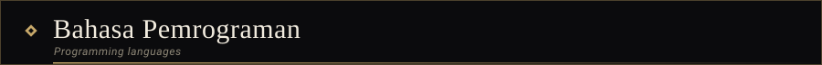

</div>


<div align="center">

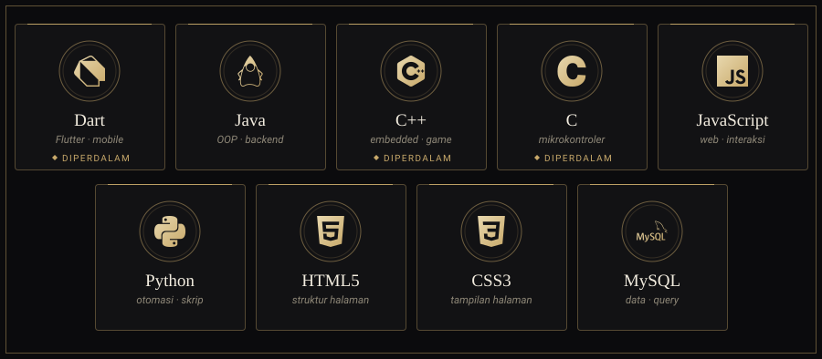

</div>

<br/>

| | Bahasa | Karakter | Aku gunakan untuk |
| :---: | :--- | :--- | :--- |
|  | **Dart** | Berorientasi objek, terkompilasi | Aplikasi mobile dan desktop dengan Flutter |
| 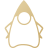 | **Java** | Berorientasi objek, bertipe statis | Logika backend, aplikasi desktop, latihan OOP |
|  | **C++** | Multi-paradigma, terkompilasi | Program berperforma tinggi, game, *embedded* |
|  | **C** | Prosedural, tingkat rendah | Mikrokontroler dan akses langsung ke perangkat keras |
|  | **JavaScript** | Dinamis, berbasis *event* | Interaksi web dan logika sisi klien |
|  | **Python** | Dinamis, serbaguna | Otomasi, skrip, dan prototipe cepat |
|   | **HTML dan CSS** | *Markup* dan *styling* | Struktur dan tampilan halaman web |
|  | **SQL** | Deklaratif | Menyimpan dan mengolah data |

<div align="center">


</div>

<div align="center">

<a name="framework-dan-tools"></a>
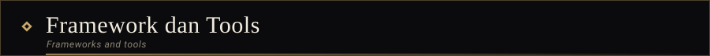

</div>


<div align="center">

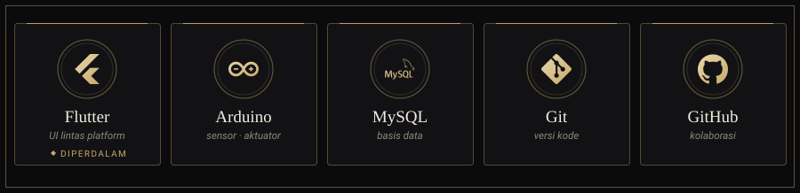

</div>

<br/>

```bash
# alur Git yang aku pakai
git checkout -b feature/nama-fitur
git add .
git commit -m "feat: tambah fitur baru"
git push -u origin feature/nama-fitur
```

<div align="center">


</div>

<div align="center">

<a name="web-dan-aplikasi"></a>
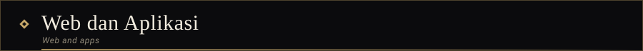

</div>


Sisi perangkat lunak: dari tampilan yang dilihat pengguna sampai logika yang bekerja di belakangnya.

| Lapisan | Wilayah yang dieksplorasi | Teknologi |
| :--- | :--- | :--- |
| **Frontend** | Antarmuka responsif, interaksi, tata letak yang rapi |    |
| **Mobile** | Aplikasi lintas platform, navigasi, pengelolaan *state* |   |
| **Backend** | Logika bisnis, REST API, struktur proyek |   |
| **Data** | Desain tabel, relasi, *query* |  |
| **Alur kerja** | Versi kode, percabangan, dokumentasi |   |

<div align="center">


</div>

<div align="center">

<a name="elektronika-dan-iot"></a>
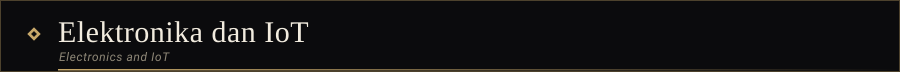

</div>


Sisi perangkat keras: tempat kode bertemu tegangan, sinyal, dan benda nyata.

<div align="center">

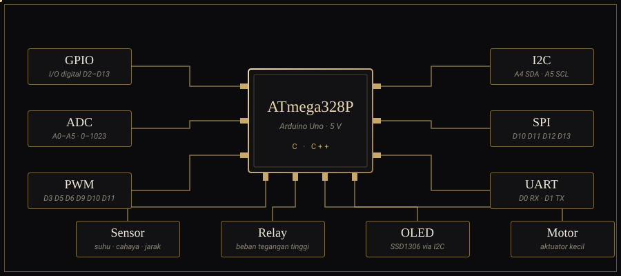

</div>

<br/>

| Wilayah | Yang dieksplorasi | Teknologi |
| :--- | :--- | :--- |
| **Sinyal** | Input/output digital, pembacaan analog (ADC), PWM | 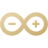   |
| **Sensor dan aktuator** | Membaca kondisi lingkungan, menggerakkan relay dan motor kecil |  |
| **Komunikasi** | Protokol serial antarkomponen: I2C, SPI, UART |   |
| **Rangkaian dasar** | Hukum Ohm, pembagi tegangan, catu daya | Elektronika dasar |
| **Otomasi** | Skrip yang mengolah data dan menjalankan tugas berulang |  |
| **Tampilan data** | Menampilkan hasil pembacaan ke layar atau aplikasi |   |

<div align="center">


</div>

<div align="center">

<a name="komponen-elektronika"></a>
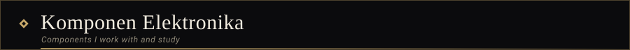

</div>


| Komponen | Fungsi utama | Contoh penggunaan |
| :--- | :--- | :--- |
| **Resistor** | Membatasi arus dan membagi tegangan | Pembatas arus LED, pembagi tegangan sensor |
| **Kapasitor** | Menyimpan muatan, menyaring (*filter*), menstabilkan catu daya | Kapasitor *decoupling* pada mikrokontroler |
| **Induktor** | Menyimpan energi dalam medan magnet | Filter dan konverter tegangan |
| **Dioda** | Mengalirkan arus satu arah | Penyearah dan proteksi polaritas |
| **LED** | Indikator cahaya | Penanda status perangkat |
| **Transistor** | Saklar elektronik dan penguat | Mengendalikan beban dari pin mikrokontroler |
| **Op-amp** | Penguat tegangan dengan umpan balik | Penguat sinyal sensor |
| **IC 555** | Pewaktu (*timer*) dan osilator | Pembangkit pulsa dan kedip LED |
| **Regulator tegangan** | Menjaga tegangan keluaran tetap stabil | 7805 untuk catu daya 5 V |
| **Relay** | Saklar yang dikendalikan sinyal listrik | Menyalakan beban bertegangan lebih tinggi |
| **Sensor** | Mengubah besaran fisik menjadi sinyal listrik | Suhu, kelembapan, cahaya, jarak |
| **Mikrokontroler** | Otak yang menjalankan program | ATmega328P pada Arduino Uno |
| **Layar OLED SSD1306** | Menampilkan teks dan grafik sederhana | Tampilan data sensor melalui I2C |

<div align="center">


</div>

<div align="center">

<a name="rumus-dasar"></a>
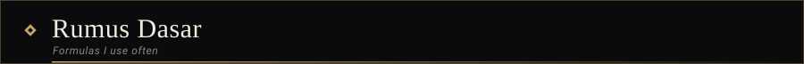

</div>


** Hukum Ohm dan daya**

```math
V = I \times R \qquad\qquad P = V \times I
```

** Rangkaian resistor**

```math
R_{seri} = R_1 + R_2 \qquad\qquad \frac{1}{R_{paralel}} = \frac{1}{R_1} + \frac{1}{R_2}
```

** Pembagi tegangan**

```math
V_{out} = V_{in} \times \frac{R_2}{R_1 + R_2}
```

** Rangkaian RC**

```math
\tau = R \times C \qquad\qquad f_c = \frac{1}{2\pi R C}
```

** Penguat operasional**

```math
A_{v(inverting)} = -\frac{R_f}{R_{in}} \qquad\qquad A_{v(non\text{-}inverting)} = 1 + \frac{R_f}{R_{in}}
```

** Konversi ADC 10-bit (Arduino Uno, referensi 5 V)**

```math
V_{in} = \frac{ADC}{1023} \times 5\,V
```

<div align="center">


</div>

<div align="center">

<a name="logika-digital"></a>
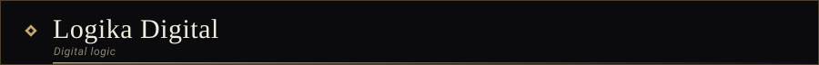

</div>


| Gerbang | Ekspresi Boolean | Keluaran bernilai 1 jika |
| :--- | :--- | :--- |
| **AND** | `A · B` | Kedua masukan bernilai 1 |
| **OR** | `A + B` | Salah satu atau kedua masukan bernilai 1 |
| **NOT** | `A'` | Masukan bernilai 0 |
| **NAND** | `(A · B)'` | Tidak semua masukan bernilai 1 |
| **NOR** | `(A + B)'` | Kedua masukan bernilai 0 |
| **XOR** | `A ⊕ B` | Kedua masukan berbeda |
| **XNOR** | `(A ⊕ B)'` | Kedua masukan sama |

<details>
<summary><b>Half adder</b>: penjumlah 1-bit</summary>

<br/>

```text
Sum   = A XOR B
Carry = A AND B

A  B | Sum  Carry
0  0 |  0     0
0  1 |  1     0
1  0 |  1     0
1  1 |  0     1
```

</details>

<div align="center">


</div>

<div align="center">

<a name="protokol-komunikasi"></a>
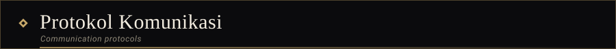

</div>


| Protokol | Jalur | Sifat | Kecepatan umum | Contoh pemakaian |
| :--- | :--- | :--- | :--- | :--- |
| **UART** | TX, RX | Asinkron, dua perangkat | 9600 hingga 115200 baud | Serial Monitor, modul GPS |
| **I2C** | SDA, SCL | Sinkron, banyak perangkat dengan alamat | 100 kHz hingga 400 kHz | Layar OLED, sensor |
| **SPI** | MOSI, MISO, SCK, CS | Sinkron, *full-duplex* | Hingga beberapa MHz | Kartu SD, layar TFT |

<div align="center">


</div>

<div align="center">

<a name="arduino-uno"></a>
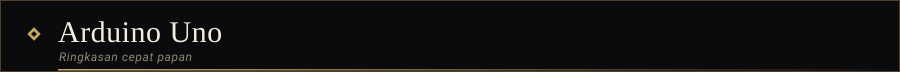

</div>


| Komponen | Spesifikasi |
| :--- | :--- |
| **Mikrokontroler** | ATmega328P, logika 5 V |
| **Pin digital** | D0 hingga D13 (D0 dan D1 dipakai untuk serial) |
| **Pin PWM** | D3, D5, D6, D9, D10, D11 |
| **Pin analog** | A0 hingga A5, ADC 10-bit (nilai 0 sampai 1023) |
| **I2C** | A4 (SDA) dan A5 (SCL) |
| **SPI** | D10 (SS), D11 (MOSI), D12 (MISO), D13 (SCK) |

<div align="center">


</div>

<div align="center">

<a name="peralatan-lab"></a>
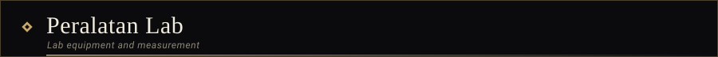

</div>


Alat yang umum dipakai dalam praktikum dan pengerjaan proyek elektronika.

| Alat | Kegunaan |
| :--- | :--- |
| **Multimeter** | Mengukur tegangan, arus, resistansi, dan kontinuitas |
| **Osiloskop** | Melihat bentuk gelombang sinyal terhadap waktu |
| **Catu daya DC** | Memberi tegangan dan batas arus yang terkontrol |
| **Function generator** | Menghasilkan sinyal uji (sinus, kotak, segitiga) |
| **Logic analyzer** | Membaca sinyal digital dan protokol komunikasi |
| **Breadboard dan kabel jumper** | Merakit prototipe tanpa solder |
| **Solder** | Menyambungkan komponen secara permanen |

<details>
<summary><b>Daftar periksa</b> saat rangkaian tidak berfungsi</summary>

<br/>

```text
[ ] Catu daya menyala dan tegangannya sesuai
[ ] Semua GND tersambung ke satu titik acuan
[ ] Polaritas komponen sudah benar (LED, dioda, kapasitor elektrolit)
[ ] Sambungan breadboard dan kabel jumper tidak longgar
[ ] Nilai resistor sesuai perhitungan
[ ] Nomor pin pada kode sama dengan pin pada rangkaian
[ ] Tegangan di titik penting sudah diukur dengan multimeter
[ ] Satu bagian diuji terpisah sebelum digabung
```

</details>

<div align="center">


</div>

<div align="center">

<a name="code-showcase"></a>
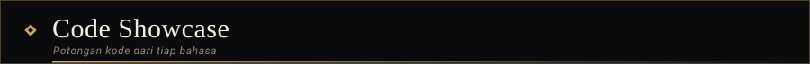

</div>


<details>
<summary> <b>Arduino / C++</b> &nbsp;·&nbsp; kedip LED tanpa <code>delay()</code></summary>

<br/>

```cpp
const int LED_PIN = 13;
const unsigned long INTERVAL = 500;

unsigned long lastToggle = 0;
bool ledOn = false;

void setup() {
  pinMode(LED_PIN, OUTPUT);
}

void loop() {
  unsigned long now = millis();
  if (now - lastToggle >= INTERVAL) {
    lastToggle = now;
    ledOn = !ledOn;
    digitalWrite(LED_PIN, ledOn ? HIGH : LOW);
  }
}
```

</details>

<details>
<summary> <b>Arduino / C++</b> &nbsp;·&nbsp; membaca sensor analog</summary>

<br/>

```cpp
const int SENSOR_PIN = A0;

void setup() {
  Serial.begin(9600);
}

void loop() {
  int raw = analogRead(SENSOR_PIN);          // 0 - 1023
  float volt = raw * (5.0 / 1023.0);         // konversi ke volt
  Serial.print("ADC: ");
  Serial.print(raw);
  Serial.print("  |  Tegangan: ");
  Serial.print(volt, 2);
  Serial.println(" V");
  delay(500);
}
```

</details>

<details>
<summary> <b>Dart / Flutter</b> &nbsp;·&nbsp; aplikasi paling minimal</summary>

<br/>

```dart
import 'package:flutter/material.dart';

void main() => runApp(const NichoApp());

class NichoApp extends StatelessWidget {
  const NichoApp({super.key});

  @override
  Widget build(BuildContext context) {
    return const MaterialApp(
      home: Scaffold(
        body: Center(child: Text('Keep Building')),
      ),
    );
  }
}
```

</details>

<details>
<summary> <b>Python</b> &nbsp;·&nbsp; merapikan folder berdasarkan ekstensi file</summary>

<br/>

```python
from pathlib import Path
import shutil


def organize(folder: str) -> None:
    root = Path(folder)
    for item in root.iterdir():
        if item.is_file() and item.suffix:
            target = root / item.suffix[1:].lower()
            target.mkdir(exist_ok=True)
            shutil.move(str(item), target / item.name)
```

</details>

<details>
<summary> <b>JavaScript</b> &nbsp;·&nbsp; debounce</summary>

<br/>

```js
const debounce = (fn, wait = 200) => {
  let timer;
  return (...args) => {
    clearTimeout(timer);
    timer = setTimeout(() => fn(...args), wait);
  };
};
```

</details>

<details>
<summary> <b>Java</b> &nbsp;·&nbsp; rata-rata nilai</summary>

<br/>

```java
public class Main {
    public static void main(String[] args) {
        int[] scores = {72, 88, 95};
        int total = 0;
        for (int s : scores) total += s;
        System.out.println("Average: " + (double) total / scores.length);
    }
}
```

</details>

<details>
<summary> <b>C</b> &nbsp;·&nbsp; operasi bit</summary>

<br/>

```c
#include <stdio.h>

int main(void) {
    unsigned char flags = 0x05;   /* 0000 0101 */
    flags |= (1 << 1);            /* set bit 1   -> 0000 0111 */
    flags &= ~(1 << 0);           /* clear bit 0 -> 0000 0110 */
    printf("flags = 0x%02X\n", flags);
    return 0;
}
```

</details>

<div align="center">


</div>

<div align="center">

<a name="pipeline-proyek"></a>
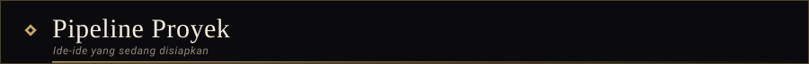

</div>


Daftar ide yang sedang dipersiapkan. Statusnya akan diperbarui seiring proyek dikerjakan.

| Proyek | Ide singkat | Stack | Status |
| :--- | :--- | :--- | :---: |
| **Smart Room Monitor** | Membaca suhu dan kelembapan ruangan, lalu menampilkannya di layar OLED |   | 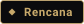 |
| **Auto Plant Watering** | Penyiram tanaman otomatis berdasarkan kelembapan tanah |   |  |
| **Device Companion App** | Aplikasi untuk memantau dan mengontrol perangkat dari ponsel |   |  |
| **Desk Automation Toolkit** | Kumpulan skrip kecil untuk pekerjaan berulang |  |  |
| **Mini Web Dashboard** | Dasbor sederhana untuk menampilkan data sensor |   |  |

<div align="center">


</div>

<div align="center">

<a name="dokumentasi-proyek"></a>
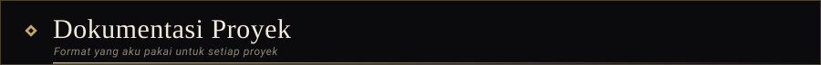

</div>


Setiap proyek didokumentasikan dengan struktur yang sama, supaya mudah dipahami dan diulang oleh orang lain.

```text
nama-proyek/
├── README.md        tujuan, cara kerja, dan cara menjalankan
├── docs/
│   ├── skema.png    skema rangkaian
│   ├── bom.md       daftar komponen (bill of materials)
│   └── pengujian.md hasil pengukuran dan pengujian
├── src/             kode sumber atau firmware
└── LICENSE
```

<div align="center">


</div>

<div align="center">

<a name="game-lab"></a>
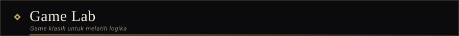

</div>


Game klasik cocok untuk melatih logika pemrograman: *game loop*, input, tabrakan, skor, dan pengelolaan *state*.

| Game | Konsep yang dilatih | Stack | Level |
| :--- | :--- | :---: | :---: |
| **Pong** | Gerak objek, tabrakan bola dengan paddle, skor |  | 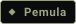 |
| **Snake** | List, arah gerak, pertumbuhan, tabrakan diri |  |  |
| **Tic-Tac-Toe** | Matriks 2D, pengecekan menang, giliran pemain |  |  |
| **Memory Match** | *State* kartu, pengacakan, pencocokan pasangan |  |  |
| **Tebak Angka** | Bilangan acak, perulangan, validasi input |  |  |
| **Breakout** | Tabrakan banyak objek, level, *power-up* |  | 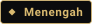 |
| **Flappy Bird** | Gravitasi, rintangan acak, skor tertinggi |  |  |
| **Minesweeper** | Grid, rekursi (*flood fill*), hitung ranjau sekitar |  |  |
| **2048** | Penggabungan elemen array, geser, kondisi menang dan kalah |  |  |
| **Tetris** | Rotasi matriks, hapus baris, kecepatan bertahap |  | 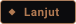 |
| **Snake di layar OLED** | *Embedded*, tombol fisik, layar SSD1306 |  |  |

<details>
<summary> <b>Kerangka game loop</b> (Python dan Pygame)</summary>

<br/>

```python
import pygame

pygame.init()
screen = pygame.display.set_mode((640, 360))
clock = pygame.time.Clock()
running = True

while running:
    for event in pygame.event.get():       # 1. baca input
        if event.type == pygame.QUIT:
            running = False

    # 2. update: gerakkan objek, cek tabrakan, hitung skor
    # 3. draw  : gambar ulang semua objek ke layar

    pygame.display.flip()
    clock.tick(60)                         # batasi 60 FPS

pygame.quit()
```

</details>

<div align="center">


</div>

<div align="center">

<a name="alur-kerja"></a>
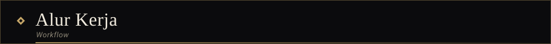

</div>


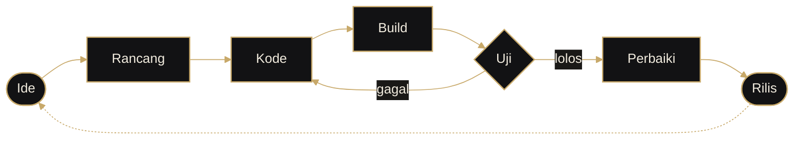

<details>
<summary><b>Struktur workspace</b></summary>

<br/>

```text
nicho/
├── software/
│   ├── web/          HTML, CSS, JavaScript
│   ├── mobile/       Flutter, Dart
│   └── backend/      Java, Python, MySQL
├── hardware/
│   ├── arduino/      sketch, sensor, aktuator
│   └── circuits/     skema dan rangkaian
├── automation/       skrip Python dan tools
└── game-lab/         latihan logika lewat game klasik
```

</details>

<div align="center">


</div>

<div align="center">

<a name="peta-belajar"></a>
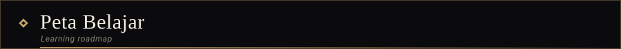

</div>


| Tahap | Fokus | Target |
| :--- | :--- | :--- |
| **1. Fondasi** | Dasar C, C++, Java, dan struktur data | Menyelesaikan semua game level Pemula |
| **2. Pengembangan** | Flutter, JavaScript, dan basis data | Aplikasi lengkap dengan penyimpanan data |
| **3. Integrasi** | Arduino, sensor, dan komunikasi perangkat | Satu proyek yang menghubungkan aplikasi dengan perangkat IoT |
| **4. Kontribusi** | Git, dokumentasi, dan *open source* | Kontribusi pertama ke proyek orang lain |

<div align="center">


</div>

<div align="center">

<a name="tanya-saya"></a>
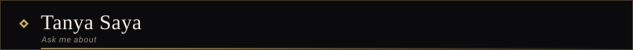

</div>


Topik yang selalu menyenangkan untuk dibahas. / Topics I'm always happy to talk about.

| Perangkat lunak / Software | Perangkat keras / Hardware |
| :--- | :--- |
| Memulai Flutter dan Dart dari nol | Memulai Arduino dari nol |
| Logika di balik game klasik | Membaca sensor dan menampilkan datanya |
| Merapikan struktur proyek | Dasar rangkaian elektronika |
| Otomasi dengan Python | Menghubungkan perangkat ke aplikasi |
| Dasar Git dan GitHub | C dan C++ untuk *embedded* |

<div align="center">


</div>

<div align="center">

<a name="statistik-github"></a>
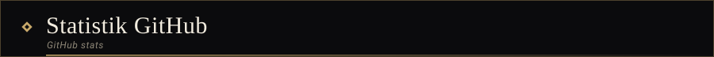

</div>


<div align="center">


&nbsp;


<br/>


<br/><br/>


<br/><br/>


</div>

<div align="center">


</div>

<div align="center">

<a name="kontak"></a>
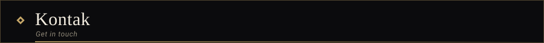

</div>


Punya ide, pertanyaan, atau proyek yang membutuhkan rekan kerja? Silakan hubungi aku lewat Instagram.

Got an idea, a question, or a project that needs another pair of hands? Feel free to reach out on Instagram.

<div align="center">

<br/>

<a href="https://instagram.com/n1kzx.z"></a>

<br/><br/>


</div>
